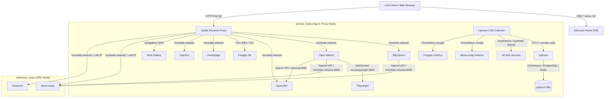

# Architecture & Repository Structure

Use the [service onboarding checklist](service-onboarding.md) for new-service integration decisions.

This document describes the architectural layout, host group design, networking topology, and directory structure of the homelab infrastructure.

---

## Overview

The homelab infrastructure automates self-hosted services using **Ansible** for centralized configuration and **Podman Quadlets** integrated into `systemd` for container management.

Key principles:
- **Rootless Containers**: All application containers run under rootless Podman environments with systemd user linger enabled.
- **Declarative Unit Files**: Services are defined as `.container` Quadlet templates deployed into `~/.config/containers/systemd/`.
- **DNS Hostname Resolution**: LAN clients resolve services using `*.home` hostnames served by the AdGuard Home DNS server on port `53`.
- **Centralized Reverse Proxy**: Caddy listens on unprivileged host port `80` to proxy incoming HTTP requests based on the `Host` header to upstream container ports. A local DNS server (AdGuard Home) publishes `*.home` records so devices without mDNS support can resolve service hostnames.

---

## Architecture & Host Groups

The inventory organizes machines into functional host groups:



### Host Group Descriptions

- **`inference_hosts`**:
  - Hosts equipped with GPUs for artificial intelligence and machine learning workloads.
  - Deploys NVIDIA Container Toolkit (CDI generation) and Quadlet services such as `llama-swap` and `SwarmUI`.
  - `llama-swap` serves as the single, unified multi-model proxy and VRAM lifecycle manager for all LLM inference traffic.
- **`service_hosts`**:
  - Hosts running application containers, proxy services, and local network utilities.
  - Deploys `caddy`, `sillytavern`, `open-webui`, `searxng`, `playwright`, `piclaw`, `webgallery`, `forgejo`, `homepage`, `glances`, `uptrace` (with ClickHouse, PostgreSQL, Redis, and an OpenTelemetry Collector), `adguardhome` (LAN DNS server & ad blocker serving `*.home` rewrites so mDNS-less devices can resolve service hostnames).
  - Frontend AI applications (`sillytavern`, `open-webui`) route model completion calls internally to `llama-swap:8080`.
  - `searxng` acts as the self-hosted search aggregator for Open WebUI web search operations over `homelab.network:8080`.
  - `playwright` handles browser rendering and content extraction for Open WebUI over `ws://playwright:3000`.
  - `glances` monitors the host (CPU, memory, temp, uptime, disk) and exposes a REST API that Homepage's Glances info widget consumes over `homelab.network`.

### Web Gallery

`webgallery` is a rootless user service on `service_hosts`, connected to
`homelab.network`. Caddy routes `https://webgallery.home` to `webgallery:3000`;
port `8084` on the host provides direct HTTP access. Its container labels place
it in Homepage's **Web Services** group.

Storage is split between an existing data directory mounted at `/data` (SQLite
database, configuration and scraper state) and a media directory at `/media`
(downloads and avatars). The existing Firefox profile is mounted read-only at
`/home/node/.mozilla/firefox` for authenticated scraping. Ansible manages both
complete configuration files; application state and media remain in their
persistent directories. Host-specific paths and desired configuration are stored
in a protected, gitignored host-variable file; extractor secrets come from Vault.
See the [configuration reference](configuration.md#web-gallery) for variables,
file locations and credential setup.

### Deployment Topologies

- **Single-Machine Deployment (Default)**:
  - Both `inference_hosts` and `service_hosts` target `desktop` via Ansible's `local` connection.
  - Upstream proxy targets default to container names on the internal bridge network (`homelab.network`).
- **Multi-Machine Expansion**:
  - Inference workloads and general application services can be split across separate physical machines simply by defining new host targets under `service_hosts` or `inference_hosts` in `inventory/hosts.yml`.
  - Caddy upstreams can be overridden in `inventory/group_vars/service_hosts.yml` to target cross-host IP addresses.

---

## Network & Traffic Flow

1. **Host Name Resolution**:
   - The AdGuard Home DNS server answers every `*.home` hostname with the host's LAN IP, and forwards all other queries upstream to Quad9.
   - Clients resolve `*.home` by pointing their DNS at the host's port `53` — on Linux, macOS, Windows, and Android alike.
2. **HTTP and HTTPS routing**:
   - System parameter `net.ipv4.ip_unprivileged_port_start = 53` allows the unprivileged Caddy container to bind host ports `80` and `443` (and AdGuard Home to bind DNS port `53`). Caddy uses its local CA; clients need the appropriate trust.
3. **Upstream Forwarding**:
   - Caddy inspects the incoming HTTP `Host` header and forwards traffic to the corresponding container service port.
4. **Unified LLM Inference Routing**:
   - `SillyTavern` connects directly to `http://llama-swap:8080/v1` over `homelab.network`.
   - `Open WebUI` connects to `http://llama-swap:8080/v1` for raw model completions over `homelab.network`.
   - `llama-swap` handles model swapping, VRAM allocation, and TTL-based model auto-unloading dynamically.
5. **Direct Port Exposure**:
   - Services with a published host port (see the README service table) can be reached at `http://<host-ip>:<port>` without DNS or the reverse proxy.
   - Forgejo binds web port `3003` and SSH port `222` directly to the host for non-proxied or SSH access.
   - When Homepage is accessed via IP, `homepage.custom.js` rewrites links for services in its explicit map using their port variables. Web Gallery is not currently in that map.

> [!NOTE]
> Direct host-port access and the Homepage IP-aware link rewriting assume a **single-host deployment** (both `inference_hosts` and `service_hosts` on the same machine, the default topology). On a split-host topology, the direct port of each service belongs to its own host, so `<host-ip>:<port>` links must be resolved per-host. This is a known limitation to be addressed in a future release.

---

## Homepage Dashboard & Container Label Discovery

[Homepage](https://gethomepage.dev) populates the dashboard dynamically from container labels via the Docker-compatible Podman socket, replacing any manual `services.yaml` definition.

### How discovery works

- The homepage container mounts the rootless Podman socket read-only and points its docker config at it:
  - `Volume=/%t/podman/podman.sock:/var/run/docker.sock:ro` in `homepage.container.j2`
  - `docker.yaml` in the homepage config dir: `my-docker: socket: /var/run/docker.sock`
- **Filename case matters**: Homepage only reads `docker.yaml` (lowercase) — see `checkAndCopyConfig("docker.yaml")` in `src/utils/config/service-helpers.js`. A differently-cased file (e.g. `Docker.yaml`) is silently ignored, which leaves discovery using the shipped skeleton (no instances): no containers are discovered and no container stats populate.
- Homepage **merges** manual `services.yaml` groups with discovered ones (`api-response.js: servicesResponse`), so a stale `services.yaml` from a previous deployment keeps resurrecting old groups. An empty (comment-only) `services.yaml` is deployed on purpose so no manual groups exist.

### Labeling containers

Every web-accessible container carries `homepage.*` labels in its quadlet template:

| Label | Example |
| :--- | :--- |
| `homepage.group` | `Label=homepage.group="Web Services"` |
| `homepage.name` | `Label=homepage.name="Open WebUI"` |
| `homepage.icon` | `Label=homepage.icon=open-webui.png` |
| `homepage.href` | `Label=homepage.href=https://openwebui.{{ lan_domain }}` |
| `homepage.description` | `Label=homepage.description="Chat & RAG frontend"` |

Optional widget labels use dot notation (`homepage.widget.type=...`, `homepage.widget.url=...`, `homepage.widget.fields=...`). Multiple widgets use an index, e.g. `homepage.widgets[0].type=...`.

**Critical quadlet quoting rule**: the Podman Quadlet generator splits `Label=` values on whitespace and strips surrounding quotes when it builds the `podman run` command. Multi-word values (including `&`) MUST be double-quoted, and JSON array values MUST be single-quoted:

- `Label=homepage.group="Web Services"` → podman stores `Web Services` (quotes stripped, space preserved)
- `Label=homepage.widget.fields='["upstreams","requests"]'` → stored as a valid JSON array

Leaving multi-word values unquoted silently produces broken labels (e.g. `homepage.description=Reverse proxy` becomes two `--label` args). Verified with `podman-system-generator` + `podman inspect`.

### Groups & layout

Label groups match the `settings.yaml` layout keys so row layouts apply. Current groups: `Inference`, `Web Services`, `Infrastructure`. Adding a new group requires a matching `layout:` entry in `homepage.settings.yaml.j2`.

### Host resource monitoring

The `glances` container publishes its REST API to the shared network, and the Homepage **Glances** info widget (`homepage.widgets.yaml.j2`) shows real **host** CPU, memory, temperature, uptime, and disk usage. Unlike the built-in `resources` widget (which reads only the Homepage container's own stats via `systeminformation`), the Glances widget reads host statistics from the Glances REST API. Glances runs with `--pid=host`, read-only `/sys`, `/etc/os-release`, and host-root (`/:/host`) mounts; the widget monitors host disk via `disk: /host`. Authentication is enforced with basic auth (`--password`) wired through `vault_glances_username` / `vault_glances_password`. A small `custom.css` rule (see below) makes the Glances widget span the full header row above the search/datetime widgets.

### Uptrace observability

Uptrace is the homelab's centralized OpenTelemetry observability platform (traces, metrics, logs). It runs as five Quadlet services on `service_hosts` — `uptrace` (APM UI + API + OTLP ingest), `uptrace-clickhouse`, `uptrace-postgres`, `uptrace-redis`, and `uptrace-otelcol` — all on the shared `homelab.network`. Only the Uptrace UI is published to the host (`14318`); all telemetry ingestion is internal to the network.

**Why the ClickHouse HTTP port is published.** The `uptrace-clickhouse` container additionally publishes its HTTP interface (`8123`) to the **host loopback only** (`PublishPort=127.0.0.1:{{ uptrace_clickhouse_http_port }}:8123`). This exists solely so a **local, read-only agent tool** (the MCP `mcp-clickhouse` server, which runs on the host) can query Uptrace's trace/metric/log tables directly while building or troubleshooting infrastructure. It is deliberately **not** published to the LAN, is **not** used for telemetry ingestion (that stays internal to `homelab.network`), and the MCP server enforces read-only queries (`CLICKHOUSE_ALLOW_WRITE_ACCESS=false`), so no agent operation can mutate or delete stored telemetry.

The OTel Collector (`uptrace-otelcol`) is the integration hub and gathers telemetry through four paths:

1. **Host metrics** — the `hostmetrics` receiver with `root_path: /host`, `--pid=host`, and read-only `/sys` + `/:/host` mounts (same pattern as Glances) reports host CPU/memory/disk/network/load.
2. **Synthetic checks** — the `httpcheck` receiver polls its configured endpoints (e.g. `open-webui:8081/health`, `searxng:8080/healthz`, `llama-swap:8080/health`, `homepage:3000/`, `forgejo:3003/`, `sillytavern:8000/`, `caddy:443/` with a `Host` header) for availability/latency, using vault basic-auth credentials for the auth-protected services (`glances`). Web Gallery is not currently an HTTP-check target.
3. **Prometheus scrape → remote write** — the `prometheus` receiver scrapes llama-swap's `/metrics` (GPU temp, VRAM, util %, power draw), Forgejo's `/metrics` (enabled via `FORGEJO__metrics__ENABLED=true`), ClickHouse's Prometheus endpoint (enabled via a `config.d/prometheus.xml` drop-in on port `9363`), and the collector's own telemetry, exported to Uptrace via `prometheusremotewrite`.
4. **Database receivers** — the `postgresql` and `redis` receivers monitor Uptrace's own PostgreSQL and Redis.

An `otlp` receiver is also wired, so any homelab service can be instrumented later to stream traces/metrics/logs directly to Uptrace. A project DSN (`http://<project_token>@uptrace.home?grpc=14317`) authenticates ingestion; Uptrace self-monitors via the same DSN so the `uptrace` service appears in the UI automatically.

#### Uptrace dashboards & monitors

Uptrace dashboards are defined as declarative YAML templates (schema v2) in `roles/quadlets/files/dashboards/` and provisioned automatically on every playbook run (when `enable_uptrace_dashboards` is true) via the Uptrace internal HTTP API: the playbook logs in as the seeded admin user, then creates (POST) or updates (PUT) each dashboard and its bundled metric monitors.

**Idempotency & UI edits.** Provisioning is idempotent — a `sha256` state file under `{{ uptrace_data_dir }}` records the last-provisioned hash of each file. A dashboard/monitor is written only when (a) its name is missing from Uptrace (POST) or (b) its YAML file in the repo changed since the last run (PUT). The state is compared against the **local files only**, never against the live Uptrace content. Consequently:

- **Tweaks made directly in the Uptrace UI are preserved** — they do not trigger a change in Ansible and are not overwritten, as long as the corresponding YAML file in the repo is left untouched.
- A managed dashboard/monitor **deleted in the UI is re-created** on the next run (the repo is authoritative for existence).
- Editing the repo YAML applies that new default wholesale, including any prior UI tweaks to that dashboard.

| Dashboard | Data source | Notable widgets |
| :--- | :--- | :--- |
| `Homelab: Host` | `system_*` hostmetrics | table per host; CPU/load, RAM & swap per `state`, filesystem per `mountpoint`, disk I/O, network connections |
| `Homelab: Service Health` | `httpcheck_*` synthetic checks | availability + latency per `http_url`, UP/DOWN gauges |
| `Homelab: GPU` | `llamaswap_gpu_*` | table per GPU; temperature, util %, VRAM usage, power draw, fan speed |
| `Homelab: Forgejo` | `gitea_*` | repositories, issues, users, webhooks, accesses, stars/watches |
| `Homelab: ClickHouse` | `ClickHouse*` Prometheus metrics | memory, disk, load average, threads, merge/partition health |
| `Homelab: Uptrace Databases` | `postgresql_*`, `redis_*` | postgres table/index sizes and rows read; redis connected/blocked clients |

Bundled **metric monitors** (manual thresholds, evaluated on the Uptrace Alerts page — notifications are UI-only; no SMTP/Telegram channel is configured): GPU temperature > 90°C, GPU VRAM usage > 95%, HTTP service down, filesystem usage > 90%.

> **Note:** Uptrace 2.0.x stores the bundled `monitors:` section only in the dashboard template files — the `/dashboards/yaml` import endpoint ignores it, so monitors are provisioned separately via the monitors API (`/monitors`) from the same YAML files (see `roles/quadlets/filter_plugins/uptrace_monitors.py`).

### Config files in the homepage config dir

| File | Purpose |
| :--- | :--- |
| `docker.yaml` | Docker/Podman socket config — the discovery source |
| `settings.yaml` | Theme, layout, `showStats: true` |
| `services.yaml` | Intentionally empty/comment-only (see below) |
| `widgets.yaml` | Info widgets (search, datetime, glances host resource monitor) |
| `bookmarks.yaml` | Bookmark groups |
| `custom.css` | Optional custom CSS served at `/api/config/custom.css`; stretches the glances info widget to full width above the search/datetime row |

`services.yaml` must exist but be empty: Homepage's `checkAndCopyConfig` re-copies its shipped skeleton (the `My First/Second/Third Group` example groups) whenever the file is absent, so an empty placeholder file is deployed to suppress those examples. An empty config parses to `null` and `parseServicesToGroups(null)` returns `[]`.

### Host validation

Homepage's middleware (`src/middleware.js`) exact-matches the full `Host` header against `HOMEPAGE_ALLOWED_HOSTS` plus `localhost:<internal-port>` defaults. Access via the published port (`localhost:3002`) never matches the internal `localhost:3000` default, so the published `host:port` list is templated from `homepage_port` and includes the host's default LAN IPv4 address (from `ansible_default_ipv4.address`) so the dashboard is reachable at `http://<host-ip>:3002` from other devices. Additional hosts/IPs can be appended via `homepage_allowed_hosts_extra`.

### Security note: rootless Podman networks do not isolate

All rootless Podman bridge networks live in a single shared network namespace, and the kernel routes between them via the bridge gateways. Separate Podman networks are separate **L2** domains, **not L3-isolated** — any container can reach any other container's IP across networks. Do not rely on a "private" network to restrict access to an unauthenticated admin/management API. (This is why Caddy's unauthenticated admin endpoint is intentionally NOT exposed for a Homepage widget: it would be reachable by every container, not just Homepage.)

---

## Container Auto-Update & Lifecycle Management

Service containers pulled from remote registries include Quadlet `AutoUpdate={{ <service>_autoupdate | default('registry') }}` directives.

Web Gallery defaults to `ghcr.io/darkkal/web-gallery:latest`, published by the
GitHub mirror for versioned releases. Its `AutoUpdate=registry` policy uses the
same timer to check the selected tag, pull a changed image and restart the user
service. Override `webgallery_image` to select a different release or registry;
`webgallery_autoupdate: disabled` holds automatic updates for this service.

### How Automated Updates Work

1. **Systemd User Timer (`podman-auto-update.timer`)**:
   - Automated updates are managed by the user systemd unit `podman-auto-update.timer`.
   - The default schedule is set to **every Tuesday at 4:00 AM** (`Tue *-*-* 04:00:00`) via a systemd drop-in override (`~/.config/systemd/user/podman-auto-update.timer.d/override.conf`).
   - When triggered, `podman auto-update` checks remote container registries for updated image tags. If a newer image is available, Podman pulls the image and restarts the container service cleanly.
   - **Smart Pre-Check for Locally Built Services (SwarmUI)**: To prevent expensive 10GB+ RAM/CPU container rebuilds when no code has changed, systemd service drop-in override (`~/.config/systemd/user/podman-auto-update.service.d/override.conf`) runs `~/homelab/bin/homelab-auto-rebuild-check.sh` before `podman auto-update`. The script checks upstream Git commit SHAs via `git ls-remote` in ~0.5 seconds. Rebuilds (`systemctl --user restart <service>-build.service`) are only triggered if new commits exist upstream; otherwise rebuilds are skipped entirely.

2. **Holding Off or Disabling Updates for Specific Services**:
   - **Disable via Inventory Variable**: Set `<service>_autoupdate: "disabled"` in `inventory/group_vars/service_hosts.yml` or `inference_hosts.yml` (e.g. `openwebui_autoupdate: "disabled"`). Re-run the site playbook to update the Quadlet unit definition.
   - **Pin Container Image Version**: Override the service image tag in Quadlet templates or inventory variables (e.g. `codeberg.org/forgejo/forgejo:10.0.0`).

3. **Manual Update Execution**:
   - Check for updates without applying:
     ```bash
     podman auto-update --dry-run
     ```
   - Trigger immediate updates across all tracked services:
     ```bash
     podman auto-update
     ```
   - Manually pull and restart a single service:
     ```bash
     podman pull ghcr.io/open-webui/open-webui:main
     systemctl --user restart open-webui.service
     ```

---

## Repository Structure

```
homelab/
├── .vault-pass                  # Vault password file (user-created, gitignored)
├── ansible.cfg                  # Ansible configuration (inventory path, roles, callbacks)
├── inventory/
│   ├── hosts.yml                # Host inventory and group mappings
│   ├── host_vars/
│   │   └── <host>/
│   │       └── webgallery.yml   # Local paths and desired config (gitignored)
│   └── group_vars/
│       ├── all/
│       │   ├── vars.yml         # Shared paths and baseline system configuration
│       │   └── vault.yml        # Encrypted secrets (gitignored)
│       ├── inference_hosts.yml  # GPU layers, context sizes, and model paths
│       └── service_hosts.yml    # Service ports, upstream addresses, and DNS hostnames
├── playbooks/
│   └── site.yml                 # Main site orchestration playbook
├── roles/
│   ├── base/                    # Core setup: directories, sysctl port 80, user lingering, Quadlet network/volume
│   ├── nvidia/                  # NVIDIA container toolkit repo setup & CDI spec generation
│   ├── quadlets/                # Jinja2 container templates & systemd user service lifecycle management
│   └── caddy/                   # Caddyfile deployment & container reload
├── docs/
│   ├── architecture.md          # Architecture and repository structure guide (this file)
│   └── configuration.md         # Configuration reference & group variable specifications
├── CONTRIBUTING.md              # Contributor guidelines, coding conventions, & agent rules
├── LICENSE                      # MIT license file
└── README.md                    # Project overview & Quick Start guide
```

Generated LAN names share the inventory `lan_domain` suffix (default `home`).
See [configuration](configuration.md#lan-hostname-suffix) for precedence,
intentional literal exceptions and the separately approved cutover boundary.
